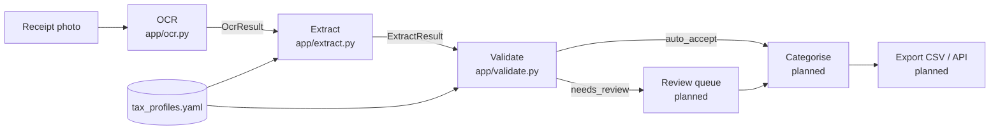

# AI Expense Tool: User and Architecture Guide

A living document. Each feature PR updates the sections it touches.

- [1. What it does](#1-what-it-does)
- [2. Using it](#2-using-it)
- [3. Architecture](#3-architecture)
- [4. Design decisions](#4-design-decisions)
- [5. How we measure](#5-how-we-measure)
- [6. Development workflow](#6-development-workflow)
- [7. Troubleshooting](#7-troubleshooting)
- [8. Roadmap](#8-roadmap)

---

## 1. What it does

Turns a photo of a receipt into structured, accounting-ready data: merchant, date, total, tax,
currency and (soon) an expense category.

The core rule: **a deterministic engine handles the numbers; AI only makes suggestions.** Every
receipt is either auto-accepted, because independent checks agree, or sent to a person with
the reason it needs a look. Nothing is silently guessed.

Current status: OCR, extraction and validation work end to end from the command line. Results are
in the [README](../README.md#results-so-far).

## 2. Using it

### Setup (Windows)

Needs Python 3.13 (the OCR engine has no build for newer Pythons yet), Node 20+ and Git.

```powershell
powershell -ExecutionPolicy Bypass -File .\setup.ps1
```

Or step by step: create `apps\api\.venv` with `py -3.13 -m venv .venv`, install
`requirements-dev.txt`, then `npm install` in `apps\web`. In VS Code, select the interpreter at
`apps\api\.venv\Scripts\python.exe`.

### Process receipts

From `apps\api`:

```powershell
# 1. OCR: writes <image>.ocr.json next to each image
.\.venv\Scripts\python -m app.ocr ..\..\data\receipts\sroie

# 2. Extract + validate + score against the SROIE answers (second argument = region profile)
.\.venv\Scripts\python ..\..\eval\extract_eval.py ..\..\data\receipts\sroie my
```

The eval prints per-field accuracy, how many receipts validation would auto-accept, how often
those are right, and every miss.

### Region profiles

Tax rates, default currency and date order live in `apps/api/config/tax_profiles.yaml`, not in code.

| Profile | Use for | Date order | Currency |
|---|---|---|---|
| `generic` | Unknown region | `unknown`: read day-first, ambiguous dates go to review | USD |
| `ch` | Switzerland | `dmy` | CHF |
| `my` | Malaysia (the SROIE dataset) | `dmy` | MYR |

To add a region, add a block to the YAML. Write rates as quoted fractions (`"0.081"`) so they load
as exact decimals. A profile must have at least one rate; use `zero: "0"` for tax-free.

### Reading a result

Every extracted field has the same shape:

```json
{ "value": "9.00", "confidence": 0.95, "source_row": 23 }
```

- `confidence` = how strong the matching rule is × OCR confidence for that row.
- `source_row` = the OCR row it came from, so the review screen can highlight it on the photo.
- A missing field is `null`, never a guess.

Validation returns `auto_accept` or `needs_review`, with every check's outcome and plain-language
reasons, e.g. `low confidence: currency (0.50)` or `total not confirmed by subtotal + tax or cash - change`.

## 3. Architecture

### Pipeline



### Modules

| Module | Input → output | Responsibility |
|---|---|---|
| `app/ocr.py` | image → `OcrResult` | Fix phone rotation, resize to ≤ 2000 px, run RapidOCR, group boxes into rows |
| `app/extract.py` | `OcrResult` + profile → `ExtractResult` | One function per field (merchant, date, total); ranked keyword rules; currency detection |
| `app/validate.py` | `ExtractResult` + profile → `ValidationResult` | Five checks; decides auto-accept vs review |
| `app/tax_profiles.py` | YAML → `TaxProfile` | Loads and validates region profiles |
| `eval/extract_eval.py` | folder of `.ocr.json` + SROIE keys → report | Scores extraction and validation |

Each stage depends only on the previous stage's output model, never on its internals. Swapping the
OCR engine means rewriting `ocr.py` only.

### Data model

- **`OcrResult`**: `lines` (text, confidence, 4-corner box, row index), `text` (rows joined), `duration_ms`.
- **`ExtractResult`**: `merchant`, `date`, `total` (amount paid, after rounding), `subtotal`, `tax`,
  `cash`, `change`, `currency`; each a `Field` with value, confidence and source row.
- **`ValidationResult`**: `status`, `checks` (name, passed / failed / could-not-run, detail), `reasons`.

Money is `Decimal` everywhere and `numeric` in the database. There is no float arithmetic on amounts.

### Validation checks

| Check | Passes when |
|---|---|
| `required_fields` | merchant, date, total and currency are all present |
| `arithmetic` | `subtotal + tax = total` (tax added on top) or `subtotal = total` (tax already included), within 0.05 |
| `tax_plausible` | `0 ≤ tax ≤ base × highest profile rate`, where base = subtotal, else total. A range, so mixed-rate receipts pass |
| `cash` | `cash − change = total`, within 0.05. Skipped when the total was itself worked out from cash |
| `sanity` | total > 0 and the date is between 2000-01-01 and today |

A check returns *could not run* when a needed field is missing. If an optional amount (tax,
change) is missing, agreement still counts as a pass, but disagreement proves nothing.

**Auto-accept policy:** no check failed; the total is confirmed by `arithmetic` or `cash`; merchant,
date and currency each have confidence ≥ 0.8.

### Repo layout

```
apps/api/        FastAPI backend (Render)
  app/           ocr.py, extract.py, validate.py, tax_profiles.py, config.py, main.py
  config/        tax_profiles.yaml
  tests/         pytest, one file per module
apps/web/        Next.js frontend (Vercel); status page for now
supabase/        database migrations
data/receipts/   receipt images and OCR output (git-ignored: may contain personal data)
eval/            evaluation scripts
docs/            this guide
```

## 4. Design decisions

| Area | Decision | Why |
|---|---|---|
| Stack | Next.js (Vercel) + FastAPI (Render) + Supabase | OCR and models need a Python server; the browser only displays and confirms. One place for money logic; secrets stay server-side |
| OCR engine | RapidOCR (PaddleOCR models on ONNX) | Strong on receipts in our tests, pip-only install, models bundled, light enough to target Render's 512 MB tier (to be measured). Tesseract is weaker on photos; full PaddleOCR is too heavy |
| Engines | One engine, no plug-in layer | Simpler. The rest of the code only sees `OcrResult`, so swapping later touches one file |
| Preprocessing | Minimal: rotation fix, RGB, resize | Modern OCR models handle the rest; add more only if measurements show a need |
| Extraction | Deterministic rules, no LLM | Explainable ("matched TOTAL ROUNDED on row 23"), free, fast, testable. AI is reserved for categorisation |
| Total definition | Amount paid, after rounding | What actually left the wallet; matches SROIE's answers |
| Rounding | A rounding row *below* the total is added; one *above* is already included | Learned from the data: receipts print both layouts |
| Currency | Never assumed. A bare `$`, or no symbol at all, means low confidence → review | Expense tools see travel receipts, where a missing symbol often means a foreign currency |
| Date order | Per profile; `unknown` for generic | `03/04` can't be resolved without knowing the region |
| Region for SROIE | `my` profile (GST 6% Apr 2015 to May 2018; SST from Sep 2018) | Under `generic`, 29 of 100 receipts went to review only because of date or currency ambiguity |
| Tolerance | Fixed 0.05 for amount comparisons | Covers cash rounding in CH and MY; simple |
| Tax check | Plausibility range, not one exact rate | Works for mixed-rate receipts and for the generic profile |
| Totals | Auto-accepted only when an independent check confirms them | Raised accuracy of auto-accepted totals from 89% to 97% (28 of 29) on fresh receipts, at the cost of a lower auto-accept rate |
| Python | Pinned to 3.13 (`.python-version`, CI, setup) | `onnxruntime` has no build for 3.15 yet |

## 5. How we measure

Ground truth comes from the [SROIE](https://rrc.cvc.uab.es/?ch=13) receipt dataset. Each receipt
has its correct company, date, address and total.

- **No tuning on the test set.** Rules were developed on receipts 000–349, then frozen and measured
  once on 350–449. Whenever a fix was inspired by a test receipt, a fresh set was used for the
  reported numbers.
- **Merchant** counts as correct at ≥ 90% text similarity, because OCR adds small character errors.
- **Only receipts with an answer are scored.** Some SROIE answers are blank.
- **What matters most** is the accuracy of *auto-accepted* receipts, because those skip human
  review. A lower auto-accept rate is acceptable; wrong auto-accepts are not.
- **Known dataset noise:** some SROIE totals are the pre-rounding amount, others the rounded one;
  at least one is the pre-tax amount.

## 6. Development workflow

1. Branch from an up-to-date `main`: `git checkout main`, `git pull`, `git checkout -b feat/<name>`.
2. Run tests (`.\.venv\Scripts\python -m pytest -q` in `apps\api`) and the eval.
3. Optional: CodeRabbit local review in VS Code (sidebar → Uncommitted → Review).
4. Commit from the **project root**, so `git add .` includes files outside `apps\api`.
5. Push and open a PR. CI runs lint, tests and the web build; CodeRabbit reviews.
6. Fix real issues with a test, reply to each comment, resolve it.
7. **Squash and merge**, then `git checkout main`, `git pull`, `git branch -D feat/<name>`.

Conventions: lean code; one function per responsibility, no speculative helpers; `Decimal` for
money; region-specific values in YAML; every bug fix comes with a test.

## 7. Troubleshooting

| Symptom | Cause | Fix |
|---|---|---|
| `onnxruntime` won't install | Python too new (e.g. 3.15) | Create the venv with `py -3.13 -m venv .venv` |
| Pylance: "Import could not be resolved" | VS Code is using a global Python | Select `apps\api\.venv\Scripts\python.exe` as the interpreter |
| Terminal `python` is the wrong version | PATH order; selecting an interpreter doesn't change the terminal | Use `.\.venv\Scripts\python`, or open a new terminal after selecting the venv |
| Eval error: `Field required ... row` | `.ocr.json` files from before rows were recorded | Re-run OCR |
| Push denied (403) for another account | Windows saved the wrong GitHub login | `git credential-manager github logout <other>`; put your username in the remote URL |
| Commits show the wrong author | Global git identity belongs to another account | `git config user.name` / `user.email` in this repo |
| A file Claude updated reverted itself | It was open in VS Code and the old buffer was saved | Close the tab before files are updated, reopen after |
| "Nothing to compare" when opening a PR | The commit went straight to `main` | Branch before committing |

## 8. Roadmap

- [x] OCR (RapidOCR)
- [x] Extract: rules, confidence, source rows, SROIE eval
- [x] Validate: five checks, review routing, Malaysia profile
- [ ] Categorise: keyword/merchant baseline vs embeddings vs small LLM, on a labelled set
- [ ] Review queue UI (Next.js)
- [ ] Export: CSV and API payload
- [ ] Deploy (Render + Vercel + Supabase) and a 60-second demo

Known issues to address: totals picked from summary rows (some ~2× too high), accounting-style
negatives like `(0.01)`, merchant names that only appear in a logo, OCR speed on Render's free tier,
and no tests yet on phone photos (SROIE receipts are scans).
